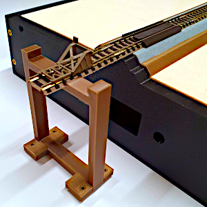
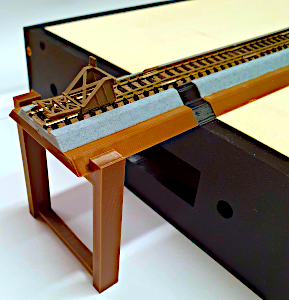
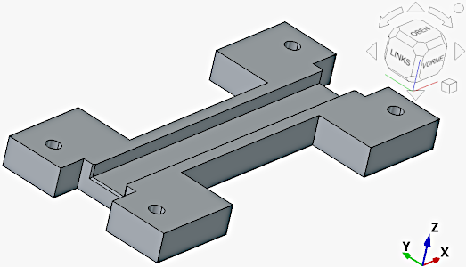
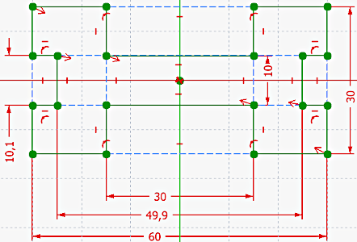
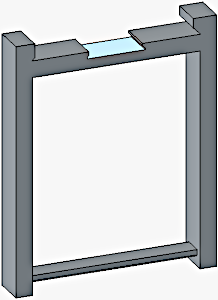
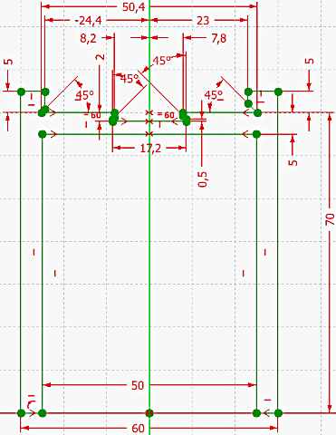
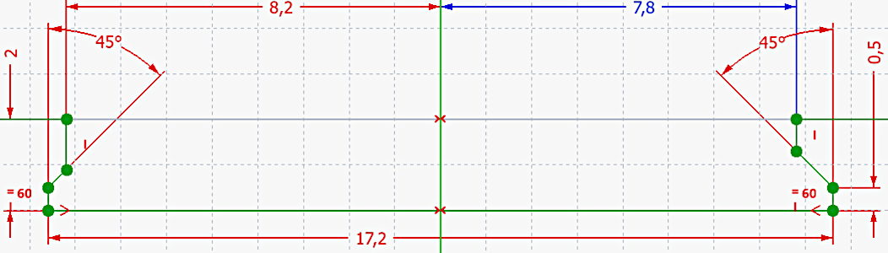

<table><tr><td></img></td><td>
<h1>Gleiserhöhungen</h1><b><big>Hilfsstützen zur Verwendung von Gleisen über dem Grundniveau.</big></b>   
Stand: 23.11.2026    &nbsp; &nbsp; &nbsp; &nbsp;
<a href="#TableOfContents">→ Inhaltsverzeichnis</a>&nbsp; &nbsp; &nbsp; &nbsp;
<a href="README.md">→ English version</a>
</td></tr></table>

   

# 🛠️ Worum geht es?
Gleisstützen dienen dazu, Gleise an den Enden eines N-Spur-Moduls zu verlängern und sicher abzustützen. Sie können sowohl für Gleise mit 3D-Bahnkörper als auch für Gleise nur mit Schotterbett verwendet werden.  

Typische Einsatzmöglichkeiten sind:  
- **Gleisverlängerung**: Verlängerung eines Gleises über das Modulende hinaus, beispielsweise für Testfahrten.
- **Anbringen eines Prellbocks**, damit beim Testen eine Lok nicht über das Modulende hinausfährt und abstürzt.

Um die Stützen leichter 3D-drucken zu können, werden sie in zwei Teile zerlegt:  
* Basisplatte
* Rahmen

  
_Bild 1: Stütze für Fleischmann-Schottergleis_  

  
_Bild 2: Stütze ohne Verwendung der Basisplatte für Gleis mit Bahnkörper_  

   

## Inhaltsverzeichnis
[1. Worum geht es?](#x10)  
[2. Basisplatte](#x20)  
[3. Rahmen](#x30)  

   

# 2. Basisplatte
Die Basisplatte ist für alle Stützen gleich:  

  
_Bild 3: Basisplatte für Gleisstützen_  

## Maße
  
_Bild 4: Abmessungen der Basisplatte für Gleisstützen_  

- **Außenmaß**: 60 x 30 mm²  
- **Stegbreite**: 10 mm  
- **Nut Querschnitt**: 6,1 mm x 2,1 mm  
- **Nut Fase**: 0,3 mm  
- **Bohrungen**: Durchmesser 2,4 mm, rechteckige, symmetrische Anordnung mit Abstand 52 mm x 20 mm  

# 3. Rahmen
Die Rahmen unterscheiden sich durch die **Höhe**:
- **25 mm** für Gleise auf Bahnkörpern und eingebauten Sensoren (Reed-Kontakt, Lichtreflexschranke).  
- **60 mm** für Gleise auf Bahnkörpern, die an Module angesteckt werden (Modulhöhe 60 mm).  
- **70 mm** für Fleischmann-Schottergleise, die an Module angesteckt werden (Modulhöhe 60 mm).  

  
_Bild 5: 70 mm Gleisstütze_  
Die Halterungen für das Schottergleis bzw. den Bahnkörper sind unsymmetrisch. Das Gleis wird in die größere Kerbe (im Bild rechts) eingesetzt und in die Halterung gedrückt.  

## Maße
  
_Bild 6: Abmessungen der Rahmen_  

  
_Bild 7: Abmessungen der Halterung für das Schottergleis_  

Der Balken unten hat einen Querschnitt von 6 x 2 mm² und ist 3 mm vom Boden entfernt.

[Zum Seitenanfang](#up)
